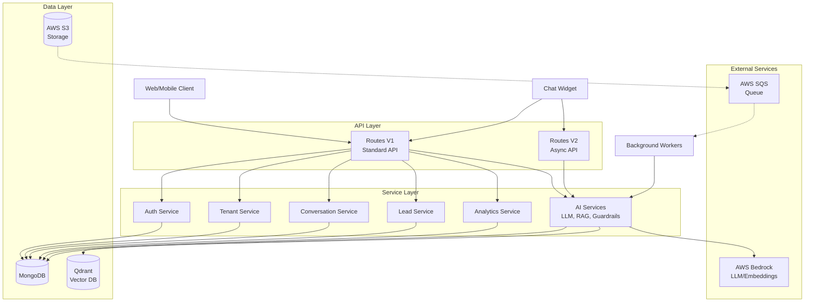
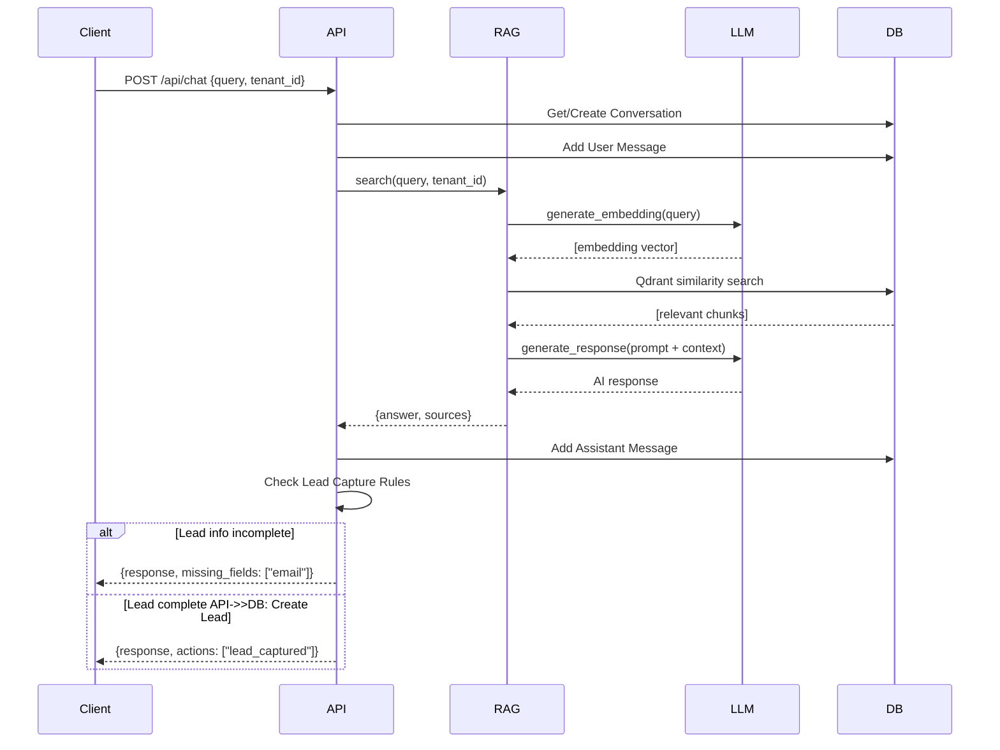
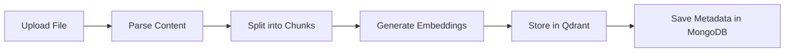

# AOB Bot - Complete Technical Documentation

> **Comprehensive guide to the AOB Bot codebase**  
> Last Updated: 2025-12-09  
> Version: 2.0.0

---

## Table of Contents

1. [Architecture Overview](#architecture-overview)
2. [Project Structure](#project-structure)
3. [Core Infrastructure](#core-infrastructure)
4. [Models](#models)
5. [Routes (API Endpoints)](#routes)
6. [Services](#services)
7. [Middleware](#middleware)
8. [Utilities](#utilities)
9. [Workers](#workers)
10. [Configuration](#configuration)

---

## Architecture Overview

AOB Bot is a **multi-tenant SaaS chatbot platform** with RAG (Retrieval-Augmented Generation) capabilities. The architecture follows a **domain-driven design** with clear separation of concerns.

### Key Technologies

| Layer | Technology | Purpose |
|-------|-----------|---------|
| API Framework | FastAPI | Async HTTP server with automatic OpenAPI docs |
| Database | MongoDB | Document store for all application data |
| Vector Database | Qdrant | Similarity search for RAG |
| LLM | AWS Bedrock (GPT-OSS 120B) | Text generation and embeddings |
| Authentication | JWT | Secure token-based auth |
| Background Jobs | Async workers | Document processing, SQS integration |

### Architecture Diagram



---

## Project Structure

```
aob_bot/
├── app/                          # Main application directory
│   ├── core/                     # Core infrastructure (4 files)
│   ├── models/                   # Data models (6 files)
│   ├── routes/                   # API endpoints
│   │   ├── v1/                   # Standard routes (7 files)
│   │   └── v2/                   # Async routes (1 file)
│   ├── services/                 # Business logic (18 files in 8 domains)
│   │   ├── auth/
│   │   ├── user/
│   │   ├── tenant/
│   │   ├── conversation/
│   │   ├── lead/
│   │   ├── ai/
│   │   ├── analytics/
│   │   └── storage/
│   ├── middleware/               # Request middleware (4 files)
│   ├── utils/                    # Utilities (4 files)
│   ├── workers/                  # Background jobs (2 files)
│   └── main.py                   # Application entry point
│
├── docs/                         # Documentation
├── scripts/                      # Utility scripts
├── tests/                        # Test files
├── .env                          # Environment configuration
├── pyproject.toml                # Dependencies (uv)
└── README.md                     # Quick start guide
```

---

## Core Infrastructure

### `app/core/config.py`

**Purpose**: Centralized application configuration using Pydantic settings.

**Key Classes**:
- `Settings`: Main configuration class loaded from environment variables

**Environment Variables**:
```python
# Database
MONGODB_URI: str = "mongodb://localhost:27017"
DB_NAME: str = "aob_bot_db"

# Qdrant Vector DB
Qdrant_URL: Optional[str] = None  # Remote Qdrant
Qdrant_PATH: str = "./data/qdrant_data"  # Local storage
QDRANT_COLLECTION_NAME: str = "aob_documents"

# AWS Bedrock (LLM)
AWS_REGION: str = "us-east-1"
BEDROCK_LLM_MODEL_ID: str = "us.amazon.nova-pro-v1:0"
BEDROCK_EMBEDDING_MODEL_ID: str = "amazon.titan-embed-text-v2:0"
BEDROCK_EMBEDDING_DIMENSIONS: int = 1024

# Authentication
JWT_SECRET_KEY: str  # REQUIRED - Must be 32+ characters
JWT_ALGORITHM: str = "HS256"
ACCESS_TOKEN_EXPIRE_MINUTES: int = 30
REFRESH_TOKEN_EXPIRE_DAYS: int = 7

# Application
APP_NAME: str = "AOB Bot RAG Backend"
CORS_ORIGINS: list = ["*"]
```

**Usage**:
```python
from app.core.config import get_settings

settings = get_settings()  # Singleton instance
mongo_uri = settings.MONGODB_URI
```

**Used By**: Every module that needs configuration (database, services, routes)

---

### `app/core/database.py`

**Purpose**: Synchronous database connection management for MongoDB and Qdrant.

**Key Classes**:
- `Database`: Singleton manager for DB connections

**Methods**:
- `get_mongo_client()`: Returns MongoDB client (singleton)
- `get_db()`: Returns MongoDB database instance
- `get_qdrant_client()`: Returns Qdrant client (singleton)
- `ensure_indexes()`: Creates all required MongoDB indexes

**Indexes Created**:
```python
# Users
db.users.create_index("user_id", unique=True)
db.users.create_index("email", unique=True)
db.users.create_index("tenant_id")

# Tenants
db.tenants.create_index("tenant_id", unique=True)
db.tenants.create_index("config.api_key", unique=True, sparse=True)

# Conversations
db.conversations.create_index("conversation_id", unique=True)
db.conversations.create_index([("tenant_id", ASCENDING), ("last_message_at", DESCENDING)])

# Messages
db.messages.create_index("message_id", unique=True)
db.messages.create_index([("conversation_id", ASCENDING), ("timestamp", ASCENDING)])

# Leads
db.leads.create_index("lead_id", unique=True)
db.leads.create_index([("tenant_id", ASCENDING), ("created_at", DESCENDING)])
db.leads.create_index([("tenant_id", ASCENDING), ("status", ASCENDING)])

# Documents
db.documents.create_index([("tenant_id", ASCENDING), ("source", ASCENDING)])
```

**Usage**:
```python
from app.core.database import get_mongo_db, get_qdrant_client

db = get_mongo_db()
qdrant = get_qdrant_client()
```

**Used By**: All service classes that need database access

---

### `app/core/async_database.py`

**Purpose**: Asynchronous database connections using Motor (async MongoDB) and AsyncQdrantClient.

**Key Classes**:
- `AsyncDatabase`: Async singleton manager

**Methods**:
- `get_mongo_client()`: Returns async MongoDB client
- `get_db()`: Returns async database
- `get_qdrant_client()`: Returns async Qdrant client
- `ensure_indexes()`: Async index creation

**Usage**:
```python
from app.core.async_database import get_async_mongo_db

db = get_async_mongo_db()
result = await db.users.find_one({"user_id": "123"})
```

**Used By**: 
- `async_tenant_service.py`
- `async_conversation_service.py`
- `async_lead_service.py`
- `async_rag_service.py`
- `async_analytics_service.py`

---

### `app/core/logging_config.py`

**Purpose**: Structured JSON logging configuration with request context tracking.

**Key Functions**:
- `setup_logging()`: Initializes logging system
- `get_logger(name)`: Returns configured logger for module

**Log Format**:
```json
{
  "timestamp": "2025-12-09T18:13:21.533622Z",
  "level": "INFO",
  "logger": "app.services.ai.rag_service",
  "message": "Document ingested successfully",
  "location": "/app/services/ai/rag_service.py:145",
  "function": "ingest_document",
  "request_id": "abc123",  // If in request context
  "user_id": "user_456"    // If authenticated
}
```

**Features**:
- JSON structured logging for easy parsing
- Request ID tracking via middleware
- User context injection
- File location and function name
- Configurable log levels

**Usage**:
```python
from app.core.logging_config import get_logger

logger = get_logger(__name__)
logger.info("Processing started", extra={"doc_id": "123"})
```

**Used By**: All modules for logging

---

## Models

All models are Pydantic classes for data validation and serialization.

### `app/models/user.py`

**Purpose**: User data model with role-based access control.

**Classes**:

#### `UserRole` (Enum)
```python
PLATFORM_ADMIN = "platform_admin"  # Full platform access
AOB_ADMIN = "aob_admin"            # Manage all tenants
CLIENT_ADMIN = "client_admin"       # Manage own tenant
CLIENT_AGENT = "client_agent"       # View own tenant data
```

#### `User` (BaseModel)
```python
user_id: str                  # UUID
email: str                    # Unique email
full_name: str               
password_hash: str            # Bcrypt hashed
role: UserRole               
tenant_id: Optional[str]      # Null for platform_admin
is_active: bool = True        
is_deleted: bool = False      # Soft delete flag
deleted_at: Optional[datetime]
created_at: datetime
```

#### `UserCreate` (BaseModel)
Request model for creating users.

#### `UserResponse` (BaseModel)
Response model (excludes password_hash).

**MongoDB Collection**: `users`

**Used By**:
- `app/services/user/user_service.py`
- `app/services/auth/auth_service.py`
- `app/routes/v1/users.py`
- `app/routes/v1/auth.py`

---

### `app/models/tenant.py`

**Purpose**: Multi-tenant configuration and settings.

**Classes**:

#### `TenantConfig` (BaseModel)
```python
api_key: Optional[str]                    # Widget authentication
welcome_message: str                      # Chat widget greeting
branding: dict                            # UI customization
tone: str = "professional"                # Response tone
language: str = "en"                      # Response language
guardrails: list = []                     # Custom restrictions
lead_trigger_count: int = 3               # Messages before lead capture
lead_form_fields: list = ["name", "email", "phone"]
```

#### `Tenant` (BaseModel)
```python
tenant_id: str                  # UUID
name: str                       # Company name
config: TenantConfig           
is_deleted: bool = False        # Soft delete
deleted_at: Optional[datetime]
created_at: datetime
updated_at: datetime
```

**MongoDB Collection**: `tenants`

**Used By**:
- `app/services/tenant/tenant_service.py`
- `app/services/tenant/async_tenant_service.py`
- `app/routes/v1/tenants.py`

---

### `app/models/conversation.py`

**Purpose**: Chat conversation and message models.

**Classes**:

#### `Conversation` (BaseModel)
```python
conversation_id: str                # UUID
tenant_id: str                      # Tenant isolation
user_identifier: Optional[str]      # Widget user ID
started_at: datetime
last_message_at: datetime
message_count: int = 0
lead_captured: bool = False         # Lead collected flag
lead_status: str = "not_started"    # Lead collection state
extracted_lead_data: dict = {}      # Partial lead info
```

#### `Message` (BaseModel)
```python
message_id: str                     # UUID
conversation_id: str
role: str                           # "user" or "assistant"
content: str                        # Message text
sources: List[str] = []             # RAG sources
timestamp: datetime
```

#### `ChatRequest` (BaseModel)
Request for /api/chat endpoint.

#### `ChatResponse` (BaseModel)
Response with answer, sources, and actions.

**MongoDB Collections**: `conversations`, `messages`

**Used By**:
- `app/services/conversation/conversation_service.py`
- `app/services/conversation/async_conversation_service.py`
- `app/routes/v1/chat.py`
- `app/routes/v2/chat.py`

---

### `app/models/lead.py`

**Purpose**: Lead capture and management.

**Classes**:

#### `LeadStatus` (Enum)
```python
NEW = "new"
CONTACTED = "contacted"
QUALIFIED = "qualified"
CONVERTED = "converted"
LOST = "lost"
```

#### `Lead` (BaseModel)
```python
lead_id: str                        # UUID
tenant_id: str
conversation_id: str
name: Optional[str]
email: Optional[str]
phone: Optional[str]
company: Optional[str]
message: Optional[str]
status: LeadStatus = LeadStatus.NEW
metadata: dict = {}                 # Additional fields
created_at: datetime
updated_at: datetime
```

**MongoDB Collection**: `leads`

**Used By**:
- `app/services/lead/lead_service.py`
- `app/services/lead/async_lead_service.py`
- `app/routes/v1/leads.py`

---

### `app/models/document.py`

**Purpose**: Document metadata for RAG knowledge base.

**Classes**:

#### `Document` (BaseModel)
```python
tenant_id: str                      # Multi-tenant isolation
source: str                         # File path or URL
document_type: str                  # "pdf", "docx", "txt", "url"
chunk_count: int                    # Number of chunks created
status: str                         # "processing", "ingested", "failed"
created_at: datetime
updated_at: datetime
```

**MongoDB Collection**: `documents`

**Qdrant Storage**:
Each document is split into chunks and stored as vectors:
```python
{
    "id": "uuid",
    "vector": [0.123, ...],  # 1024-dim embedding
    "payload": {
        "tenant_id": "...",
        "source": "contract.pdf",
        "text": "chunk content",
        "chunk_index": 0
    }
}
```

**Used By**:
- `app/services/ai/rag_service.py`
- `app/services/ai/async_rag_service.py`
- `app/routes/v1/documents.py`

---

## Routes

### V1 Routes (Standard API)

Location: `app/routes/v1/`

All V1 routes are **synchronous** and use standard database operations.

---

#### `app/routes/v1/auth.py`

**Purpose**: Authentication endpoints for registration, login, token refresh.

**Endpoints**:

| Method | Path | Auth | Description |
|--------|------|------|-------------|
| POST | `/api/auth/register` | Public | Register new user |
| POST | `/api/auth/login` | Public | Login and get JWT tokens |
| POST | `/api/auth/refresh` | Refresh Token | Get new access token |
| GET | `/api/auth/me` | JWT | Get current user info |

**Dependencies**:
- `app/services/auth/auth_service.py` - Authentication logic
- `app/services/user/user_service.py` - User management
- `app/utils/security.py` - Password hashing

**Example**:
```bash
# Register
curl -X POST http://localhost:8000/api/auth/register \
  -H "Content-Type: application/json" \
  -d '{
    "email": "user@example.com",
    "password": "SecurePass123",
    "full_name": "John Doe",
    "role": "client_admin",
    "tenant_id": "tenant-uuid"
  }'

# Login
curl -X POST http://localhost:8000/api/auth/login \
  -H "Content-Type: application/json" \
  -d '{
    "email": "user@example.com",
    "password": "SecurePass123"
  }'
```

---

#### `app/routes/v1/users.py`

**Purpose**: User management endpoints (CRUD operations).

**Endpoints**:

| Method | Path | Auth | Description |
|--------|------|------|-------------|
| POST | `/api/users` | Admin Only | Create new user |
| GET | `/api/users` | JWT | List users (filtered by role) |
| GET | `/api/users/{user_id}` | JWT | Get user details |
| PUT | `/api/users/{user_id}` | JWT | Update user |
| DELETE | `/api/users/{user_id}` | Admin Only | Soft delete user |

**Role-Based Filtering**:
- `platform_admin`: See all users
- `aob_admin`: See all users
- `client_admin`: See only users from own tenant
- `client_agent`: See only users from own tenant

**Dependencies**:
- `app/services/user/user_service.py`
- `app/utils/dependencies.py` - Role checking

---

#### `app/routes/v1/tenants.py`

**Purpose**: Tenant management and configuration.

**Endpoints**:

| Method | Path | Auth | Description |
|--------|------|------|-------------|
| POST | `/api/tenants` | Admin Only | Create tenant |
| GET | `/api/tenants` | Admin Only | List tenants |
| GET | `/api/tenants/{tenant_id}` | JWT | Get tenant details |
| PUT | `/api/tenants/{tenant_id}` | Admin/Owner | Update tenant config |
| DELETE | `/api/tenants/{tenant_id}` | Admin Only | Soft delete tenant |
| POST | `/api/tenants/{tenant_id}/generate-api-key` | Admin/Owner | Generate widget API key |
| GET | `/api/tenants/{tenant_id}/welcome` | Public | Get welcome message for widget |

**API Key Generation**:
Generates a secure API key for widget authentication:
```python
api_key = f"aob_{uuid.uuid4().hex}"
# Stored in tenant.config.api_key
```

**Dependencies**:
- `app/services/tenant/tenant_service.py`

---

#### `app/routes/v1/chat.py`

**Purpose**: Conversational chat interface with RAG and lead capture.

**Endpoints**:

| Method | Path | Auth | Description |
|--------|------|------|-------------|
| POST | `/api/chat` | API Key or Public | Send message and get AI response |
| GET | `/api/chat/conversations/{conversation_id}/messages` | JWT | Get conversation messages |
| GET | `/api/chat/tenants/{tenant_id}/conversations` | JWT |  Get tenant conversations |
| POST | `/api/chat/sessions/{conversation_id}/clear` | Public | Clear session history |
| POST | `/api/chat/sessions/reset` | Public | Start new session |

**Chat Flow**:


**Lead Capture Logic**:
1. Check if `message_count >= tenant.config.lead_trigger_count`
2. Extract entities from user message using LLM
3. Track `extracted_lead_data` in conversation
4. Return `missing_fields` to guide conversation
5. Create lead when all required fields collected

**Authentication**:
- **Widget**: Uses `X-API-Key` header
- **Authenticated**: Uses JWT `Authorization: Bearer` header
- **Public**: No auth required (for public widgets)

**Dependencies**:
- `app/services/ai/rag_service.py` - RAG and LLM
- `app/services/conversation/conversation_service.py` - Message storage
- `app/services/conversation/conversation_history_service.py` - Session management
- `app/services/lead/lead_service.py` - Lead creation
- `app/services/tenant/tenant_service.py` - Config retrieval

---

#### `app/routes/v1/documents.py`

**Purpose**: Document ingestion for knowledge base.

**Endpoints**:

| Method | Path | Auth | Description |
|--------|------|------|-------------|
| POST | `/api/documents/ingest` | JWT | Upload and ingest document |
| POST | `/api/documents/upload-to-s3` | JWT | Upload to S3 (async processing) |

**Supported Formats**:
- PDF (`.pdf`)
- Word Documents (`.docx`)
- Plain Text (`.txt`)

**Ingestion Process**:


**S3 Upload Flow** (Async Processing):
1. Upload file to S3
2. Send SQS message with file location
3. Background worker processes document
4. Worker ingests into Qdrant

**Dependencies**:
- `app/services/ai/rag_service.py` - Document processing
- `app/services/storage/storage_service.py` - S3 upload
- `app/services/storage/queue_service.py` - SQS messaging

---

#### `app/routes/v1/leads.py`

**Purpose**: Lead management and retrieval.

**Endpoints**:

| Method | Path | Auth | Description |
|--------|------|------|-------------|
| POST | `/api/leads` | Public | Create lead (for widgets) |
| GET | `/api/leads/{lead_id}` | JWT | Get lead details |
| GET | `/api/leads/tenants/{tenant_id}/all` | JWT | List tenant leads |
| PUT | `/api/leads/{lead_id}/status` | JWT | Update lead status |

**Status Filtering**:
```python
GET /api/leads/tenants/{id}/all?status=new
# Returns only leads with status="new"
```

**Dependencies**:
- `app/services/lead/lead_service.py`

---

#### `app/routes/v1/analytics.py`

**Purpose**: Analytics and reporting.

**Endpoints**:

| Method | Path | Auth | Description |
|--------|------|------|-------------|
| GET | `/api/analytics/tenants/{tenant_id}/stats` | JWT | Get tenant statistics |
| GET | `/api/analytics/platform/stats` | Admin Only | Get platform-wide stats |
| GET | `/api/analytics/tenants/{tenant_id}/daily` | JWT | Get daily metrics (7 days) |

**Stats Response**:
```json
{
  "conversations": 150,
  "leads": 45,
  "documents": 12,
  "leads_by_status": {
    "new": 20,
    "contacted": 15,
    "qualified": 5,
    "converted": 3,
    "lost": 2
  },
  "conversion_rate": 30.0,
  "generated_at": "2025-12-09T18:00:00Z"
}
```

**Performance Optimization**:
Uses single MongoDB aggregation pipeline instead of multiple queries (6x faster).

**Dependencies**:
- `app/services/analytics/analytics_service.py`

---

### V2 Routes (Async High-Performance)

Location: `app/routes/v2/`

#### `app/routes/v2/chat.py`

**Purpose**: High-performance async chat endpoint using Motor and async services.

**Endpoints**:

| Method | Path | Auth | Description |
|--------|------|------|-------------|
| POST | `/api/v2/chat` | API Key or Public | Async chat (100x more concurrent) |
| GET | `/api/v2/chat/{conversation_id}/messages` | JWT | Get messages (async) |

**Performance Benefits**:
- **Non-blocking I/O**: All database and LLM calls are async
- **Concurrency**: Handles 1000+ simultaneous requests
- **Thread Pool**: LLM calls offloaded to thread pool via `run_in_executor`

**Implementation**:
```python
async def chat_async(request: ChatRequest):
    # All operations are non-blocking
    conversation = await async_conversation_service.get_conversation(...)
    answer, sources = await async_rag_service.answer_query(...)
    await async_conversation_service.add_message(...)
    return ChatResponse(...)
```

**Dependencies**:
- `app/services/tenant/async_tenant_service.py`
- `app/services/conversation/async_conversation_service.py`
- `app/services/lead/async_lead_service.py`
- `app/services/ai/async_rag_service.py`
- `app/services/ai/async_llm_service.py`

---

*[Documentation continues with Services section in next part...]*

---

## Services

### Authentication & User Management

#### `app/services/auth/auth_service.py`

**Purpose**: User authentication, JWT token management.

**Key Methods**:

```python
class AuthService:
    def login(email: str, password: str) -> dict:
        """
        Authenticates user and returns JWT tokens.
        
        Security Checks:
        - Verifies password with bcrypt
        - Checks user is active
        - Checks user is not deleted
        - Returns access + refresh tokens
        """
        
    def refresh_token(refresh_token: str) -> dict:
        """Generates new access token from refresh token."""
        
    def hash_password(password: str) -> str:
        """Hashes password with bcrypt (cost factor 12)."""
        
    def verify_password(plain: str, hashed: str) -> bool:
        """Verifies password against hash."""
```

**Security Features**:
- Bcrypt password hashing (cost=12)
- JWT access tokens (30min expiry)
- JWT refresh tokens (7 day expiry)
- Soft-deleted users cannot login
- Inactive users cannot login

**Token Payload**:
```json
{
  "sub": "user_id",
  "email": "user@example.com",
  "role": "client_admin",
  "tenant_id": "tenant-uuid",
  "exp": 1234567890
}
```

**Used By**:
- `app/routes/v1/auth.py`
- `app/utils/dependencies.py` (token validation)

---

#### `app/services/user/user_service.py`

**Purpose**: User CRUD operations with role-based filtering.

**Key Methods**:

```python
class UserService:
    def create_user(user_data: UserCreate) -> User:
        """Creates user with hashed password."""
        
    def get_user(user_id: str) -> Optional[User]:
        """Gets user (excludes soft-deleted)."""
        
    def get_user_by_email(email: str) -> Optional[User]:
        """Gets user by email (excludes soft-deleted)."""
        
    def list_users(
        skip: int = 0,
        limit: int = 100,
        tenant_id: Optional[str] = None
    ) -> List[User]:
        """Lists users with optional tenant filter."""
        
    def update_user(user_id: str, updates: dict) -> Optional[User]:
        """Updates user fields."""
        
    def delete_user(user_id: str) -> bool:
        """Soft deletes user (sets is_deleted=True)."""
```

**Soft Delete**:
When a user is deleted:
```python
{
    "is_deleted": True,
    "deleted_at": "2025-12-09T18:00:00Z"
}
```
Deleted users are filtered out from all queries.

**Used By**:
- `app/routes/v1/users.py`
- `app/routes/v1/auth.py`
- `app/services/auth/auth_service.py`

---

### Tenant Management

#### `app/services/tenant/tenant_service.py`

**Purpose**: Tenant configuration and API key management with caching.

**Key Methods**:

```python
class TenantService:
    # In-memory cache with 5-minute TTL
    _cache = {}
    CACHE_TTL_SECONDS = 300
    
    def create_tenant(tenant_data: TenantCreate) -> Tenant:
        """Creates new tenant with default config."""
        
    def get_tenant(tenant_id: str) -> Optional[Tenant]:
        """Gets tenant (excludes soft-deleted)."""
        
    def get_tenant_cached(tenant_id: str) -> Optional[Tenant]:
        """Gets tenant with in-memory caching."""
        
    def invalidate_cache(tenant_id: str):
        """Removes tenant from cache."""
        
    def update_tenant(tenant_id: str, updates: TenantUpdate) -> Optional[Tenant]:
        """Updates tenant and invalidates cache."""
        
    def delete_tenant(tenant_id:str) -> bool:
        """Soft deletes tenant."""
        
    def generate_api_key(tenant_id: str) -> str:
        """Generates unique API key for widget."""
        
    def validate_api_key(api_key: str) -> Optional[str]:
        """Validates API key and returns tenant_id."""
```

**Caching Strategy**:
- Cache tenant config for 5 minutes
- Reduces DB hits on every chat message
- Invalidated on tenant updates
- Cache structure: `{tenant_id: (tenant, expiry_timestamp)}`

**API Key Format**:
```python
api_key = f"aob_{uuid.uuid4().hex}"
# Example: "aob_a1b2c3d4e5f6..."
```

**Used By**:
- `app/routes/v1/tenants.py`
- `app/routes/v1/chat.py` (API key validation)
- `app/services/tenant/async_tenant_service.py` (async version)

---

#### `app/services/tenant/async_tenant_service.py`

**Purpose**: Async version of tenant service using Motor.

Identical API to `tenant_service.py` but all methods are `async`.

**Key Difference**:
```python
# Sync version
tenant = tenant_service.get_tenant(tenant_id)

# Async version
tenant = await async_tenant_service.get_tenant(tenant_id)
```

**Used By**:
- `app/routes/v2/chat.py`

---

### Conversation Management

#### `app/services/conversation/conversation_service.py`

**Purpose**: Permanent conversation and message storage.

**Key Methods**:

```python
class ConversationService:
    def create_conversation(
        tenant_id: str,
        user_identifier: Optional[str] = None
    ) -> Conversation:
        """Creates new conversation."""
        
    def get_conversation(conversation_id: str) -> Optional[Conversation]:
        """Gets conversation by ID."""
        
    def add_message(
        conversation_id: str,
        role: str,  # "user" or "assistant"
        content: str,
        sources: List[str] = None
    ) -> Message:
        """
        Adds message to conversation.
        Updates conversation metadata:
        - last_message_at
        - message_count (incremented)
        """
        
    def get_messages(
        conversation_id: str,
        skip: int = 0,
        limit: int = 50
    ) -> List[Message]:
        """Gets messages with pagination."""
        
    def get_tenant_conversations(
        tenant_id: str,
        skip: int = 0,
        limit: int = 100
    ) -> List[Conversation]:
        """Lists conversations for tenant."""
        
    def mark_lead_captured(conversation_id: str):
        """Marks conversation as having captured lead."""
        
    def update_extracted_data(conversation_id: str, data: dict):
        """Updates partial lead data during collection."""
```

**Message Storage**:
Messages are stored permanently for:
- Audit trails
- Analytics
- Compliance
- Customer history

**Used By**:
- `app/routes/v1/chat.py`
- `app/services/conversation/async_conversation_service.py`

---

#### `app/services/conversation/conversation_history_service.py`

**Purpose**: Session-based conversation history with TTL and sliding window for LLM context.

**Why Separate from ConversationService?**
- **Permanent Storage** (conversation_service): All messages forever
- **Session Storage** (history_service): LLM context only, auto-expires

**Key Methods**:

```python
class ConversationHistoryService:
    def add_to_history(
        conversation_id: str,
        role: str,
        content: str
    ):
        """
        Adds message to session history.
        - Auto-expires after 30 minutes of inactivity
        - Maintains sliding window (last 10 messages)
        - Truncates long messages to 500 chars
        """
        
    def get_history(conversation_id: str) -> List[dict]:
        """Gets recent conversation history for LLM context."""
        
    def clear_history(conversation_id: str):
        """Clears session history (logout, reset)."""
        
    def cleanup_expired_sessions():
        """Background task to remove expired sessions."""
```

**MongoDB Document**:
```json
{
  "_id": "session_abc123",
  "conversation_id": "conv_uuid",
  "history": [
    {"role": "user", "content": "Hello", "timestamp": "..."},
    {"role": "assistant", "content": "Hi!", "timestamp": "..."}
  ],
  "last_activity": "2025-12-09T18:30:00Z",
  "created_at": "2025-12-09T18:00:00Z",
  "expires_at": "2025-12-09T18:30:00Z"  // 30min from last activity
}
```

**TTL Index**:
MongoDB automatically deletes documents when `expires_at` is reached.

**Used By**:
- `app/routes/v1/chat.py`

---

#### `app/services/conversation/async_conversation_service.py`

**Purpose**: Async version of conversation service.

All methods are identical to `conversation_service.py` but use `async`/`await`.

**Used By**:
- `app/routes/v2/chat.py`

---

### Lead Management

#### `app/services/lead/lead_service.py`

**Purpose**: Lead CRUD and status management.

**Key Methods**:

```python
class LeadService:
    def create_lead(lead_data: LeadCreate) -> Lead:
        """Creates new lead with status="new"."""
        
    def get_lead(lead_id: str) -> Optional[Lead]:
        """Gets lead by ID."""
        
    def get_conversation_lead(conversation_id: str) -> Optional[Lead]:
        """
        Gets lead by conversation ID.
        Prevents duplicate lead creation.
        """
        
    def list_leads(
        tenant_id: str,
        status: Optional[str] = None,
        skip: int = 0,
        limit: int = 100
    ) -> List[Lead]:
        """Lists leads with optional status filter."""
        
    def update_lead_status(
        lead_id: str,
        status: LeadStatus
    ) -> Optional[Lead]:
        """Updates lead status (new -> contacted -> qualified -> converted)."""
```

**Lead Lifecycle**:
```
new -> contacted -> qualified -> converted
                            \-> lost
```

**Duplicate Prevention**:
Checks if lead already exists for conversation before creating:
```python
existing = lead_service.get_conversation_lead(conversation_id)
if existing:
    return existing  # Don't create duplicate
```

**Used By**:
- `app/routes/v1/leads.py`
- `app/routes/v1/chat.py` (lead creation)

---

#### `app/services/lead/async_lead_service.py`

**Purpose**: Async version of lead service.

**Used By**:
- `app/routes/v2/chat.py`

---

### AI Services

#### `app/services/ai/llm_service.py`

**Purpose**: AWS Bedrock integration for LLM and embeddings.

**Key Methods**:

```python
class BedrockService:
    # LLM: us.amazon.nova-pro-v1:0 (GPT-OSS 120B)
    # Embeddings: amazon.titan-embed-text-v2:0 (1024-dim)
    
    def generate_response(prompt: str) -> str:
        """
        Generates text completion using LLM.
        
        Parameters:
        - temperature: 0.7
        - max_tokens: 2000
        - top_p: 0.9
        """
        
    def generate_rag_response(
        query: str,
        context: str,
        conversation_history: List[dict] = None,
        system_prompt: str = None
    ) -> str:
        """Generates response with RAG context."""
        
    def generate_embedding(text: str) -> List[float]:
        """
        Generates 1024-dim embedding vector.
        Used for: document chunks, query embeddings
        """
        
    def generate_embeddings_batch(texts: List[str]) -> List[List[float]]:
        """
        Batch embedding generation.
        Significantly faster for document ingestion.
        """
        
    def extract_lead_info(text: str, fields: List[str]) -> dict:
        """
        Structured entity extraction using tool calling.
        
        Example:
        text = "I'm John Doe, email john@example.com"
        fields = ["name", "email"]
        
        Returns:
        {
            "name": "John Doe",
            "email": "john@example.com"
        }
        """
```

**Authentication**:
Uses AWS bearer token from `AWS_BEARER_TOKEN_BEDROCK` environment variable.

**Error Handling**:
- Automatic retries (3 attempts)
- Fallback parsing for JSON extraction
- Timeout handling

**Used By**:
- `app/services/ai/rag_service.py`
- `app/services/ai/async_llm_service.py` (async wrapper)
- `app/routes/v1/chat.py`

---

#### `app/services/ai/async_llm_service.py`

**Purpose**: Async wrapper for LLM service using `run_in_executor`.

**Why `run_in_executor`?**
- `boto3` is synchronous (no official async version compatible)
- `run_in_executor` offloads blocking calls to thread pool
- Prevents blocking the async event loop

**Implementation**:

```python
_executor = ThreadPoolExecutor(max_workers=10)

async def generate_embedding_async(text: str) -> List[float]:
    loop = asyncio.get_event_loop()
    return await loop.run_in_executor(
        _executor,
        llm_service.generate_embedding,
        text
    )

async def generate_embeddings_batch_async(texts: List[str]) -> List[List[float]]:
    # Concurrent processing
    tasks = [generate_embedding_async(text) for text in texts]
    return await asyncio.gather(*tasks)
```

**Performance**:
- Non-blocking: Event loop continues during LLM calls
- Concurrent: Multiple requests processed simultaneously
- Thread pool prevents thread exhaustion

**Used By**:
- `app/services/ai/async_rag_service.py`
- `app/routes/v2/chat.py`

---

*[To be continued with remaining services...]*
