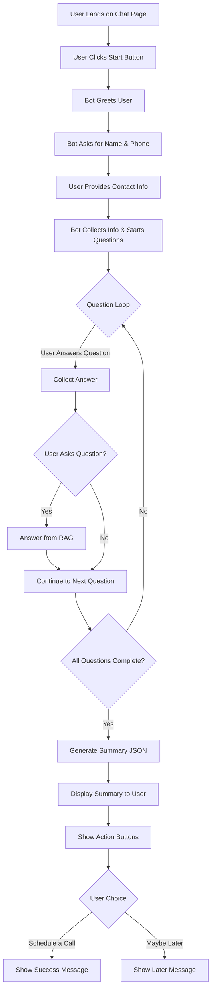
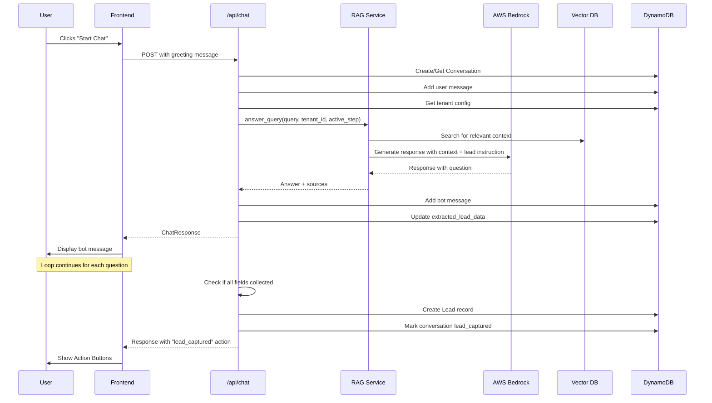

# Sales Bot Lead Capturing Process - Complete Documentation

## Table of Contents
1. [Desired Sales Bot Flow](#desired-sales-bot-flow)
2. [Technical Architecture](#technical-architecture)
3. [Current Implementation Status](#current-implementation-status)
4. [What's Implemented ✅](#whats-implemented-)
5. [What's Remaining ⚠️](#whats-remaining-%EF%B8%8F)
6. [Detailed TODO List](#detailed-todo-list)

---

## Desired Sales Bot Flow

### User Journey Overview



### Detailed Step-by-Step Flow

#### **Step 1: User Clicks Start Button**
- **Location**: Frontend `ChatPage.tsx` → Welcome Screen
- **Action**: `handleStart()` function is triggered in `useChatSession.ts`
- **Behavior**: 
  - Sets `hasStarted = true`
  - Sends implicit message to backend: "Hello! I'm interested in {companyName}"
  - Backend processes this as first user message

#### **Step 2: Bot Greets the User**
- **Location**: Backend `chat.py` → RAG Service
- **Action**: Backend receives start message and generates greeting
- **Behavior**:
  - Uses first qualification question (typically "contact" step with greeting instruction)
  - Returns greeting message asking for name and phone
  - Message includes `[STEP:contact]` tag to track progress

#### **Step 3: Ask for Name and Phone Number**
- **Location**: Backend lead qualification logic in `chat.py`
- **Behavior**:
  - Checks `qualification_questions` from tenant config
  - First question typically collects: `["name", "phone"]`
  - RAG service constructs prompt with instruction to ask for these fields
  - LLM generates natural question asking for both pieces of information

#### **Step 4: User Answers**
- **Location**: Frontend `ChatInput` component → `handleSendMessage()`
- **Behavior**:
  - User types response and sends
  - Message stored in frontend state
  - Sent to backend `/api/chat` endpoint

#### **Step 5: Collect Info and Start Questions Loop**
- **Location**: Backend `chat.py` (lines 76-143)
- **The "Ear" - Entity Extraction**:
  ```python
  new_data = llm_service.extract_lead_info(
      request.query, config.lead_form_fields
  )
  current_data.update(new_data)
  ```
  - Extracts name, phone from user's message
  - Stores in `conversation.extracted_lead_data`
  
- **The "Brain" - Determine Next Step**:
  ```python
  for step in all_steps:
      step_missing = [f for f in step.collects if f not in current_data]
      if step_missing:
          active_step = step.model_dump()
          break
  ```
  - Identifies which fields are still missing
  - Determines the active qualification question

#### **Step 6: Question Loop**
- **Location**: Backend RAG Service `answer_query()` method
- **Behavior**:
  - For each step in `qualification_questions`:
    - Check if fields from `step.collects` are in `extracted_lead_data`
    - If missing, set as `active_step`
    - Generate response asking for those fields
    - Continue until all fields collected

- **Questions typically asked** (from `config.ts`):
  1. **Contact**: Name and Phone
  2. **Location**: Preferred area/location
  3. **Budget**: Budget range
  4. **Type**: Property type (2BHK, 3BHK, etc.)
  5. **Move-in**: Timeline for moving in
  6. **Financing**: Need for home loan

#### **Step 7: Handle User Questions During Loop**
- **Location**: RAG Service `answer_query()` with conversation history
- **RAG (Retrieval Augmented Generation) Flow**:
  ```python
  # 1. Search knowledge base
  context_chunks = self.search(query, tenant_id)
  
  # 2. Get conversation history
  conversation_history = conversation_service.get_context_history()
  
  # 3. Build prompt with context
  prompt = f"""
  KNOWLEDGE BASE CONTEXT: {context_text}
  CONVERSATION HISTORY: {history_text}
  CURRENT CUSTOMER MESSAGE: {query}
  """
  
  # 4. Generate response
  answer = llm_service.generate_response(prompt)
  ```

- **Behavior**:
  - If user asks "What's the price?" or similar
  - RAG searches Qdrant vector database for relevant information
  - Combines search results with conversation context
  - Generates answer using AWS Bedrock LLM
  - **Immediately after answering, asks the next qualification question**
  - This is enforced via system prompt instruction

#### **Step 8: Collect All Answers**
- **Location**: Backend conversation storage in DynamoDB
- **Data Structure**:
  ```python
  conversation.extracted_lead_data = {
      "name": "John Doe",
      "phone": "+1234567890",
      "location": "Whitefield",
      "budget": "₹80L - ₹1.2 Cr",
      "type": "3 BHK",
      "moveIn": "Within 3 Months",
      "financing": "Yes, need home loan"
  }
  ```

#### **Step 9: Generate Summary JSON**
- **Location**: Backend `chat.py` lead capture finalization (lines 121-140)
- **Trigger**: When `missing_fields` is empty and `active_step` is None
- **Behavior**:
  ```python
  if not missing_fields and not active_step:
      # Create Lead
      lead_create = LeadCreate(
          tenant_id=request.tenant_id,
          conversation_id=conversation.conversation_id,
          name=current_data.get("name"),
          phone=current_data.get("phone"),
          # ... other fields
          metadata=current_data
      )
      lead_service.create_lead(lead_create)
      conversation_service.mark_lead_captured(conversation_id)
      suggested_actions.append("lead_captured")
  ```

- **Summary Format** (Expected from LLM):
  ```json
  {
    "summary": {
      "name": "John Doe",
      "phone": "+1234567890",
      "location": "Whitefield",
      "budget": "₹80L - ₹1.2 Cr",
      "type": "3 BHK",
      "moveIn": "Within 3 Months",
      "financing": "Yes, need home loan"
    },
    "message": "Perfect! I've noted your preferences..."
  }
  ```

#### **Step 10: Display Summary to User**
- **Location**: Frontend - should parse summary from bot response
- **Current Status**: ⚠️ NOT FULLY IMPLEMENTED
- **Expected Behavior**:
  - Parse JSON from LLM response
  - Display formatted summary in chat bubble
  - Show `showActions = true` flag

#### **Step 11: Show Action Buttons**
- **Location**: Frontend `ActionButtons` component in `ChatPage.tsx` (lines 151-158)
- **Buttons**:
  - "Schedule a Call" → calls `handleScheduleCall()`
  - "Maybe Later" → calls `handleMaybeLater()`

#### **Step 12: Display Hardcoded Messages**
- **Location**: Frontend `useChatSession.ts` (lines 275-289)
- **Messages** (from `config.ts`):
  ```typescript
  scheduleSuccess: "Fantastic! I've forwarded your details to our priority sales team..."
  maybeLater: "No problem! I've saved your preferences..."
  ```
- **Behavior**:
  - Sends user choice to backend
  - Sets `isChatEnded = true`
  - Chat interface becomes read-only

---

## Technical Architecture

### Frontend Architecture

```
qbot/
├── pages/
│   └── ChatPage.tsx           # Main chat interface
├── hooks/
│   └── useChatSession.ts      # Chat state management
├── services/
│   ├── chatService.ts         # API communication
│   └── bedrockService.ts      # Legacy service (not used with new backend)
├── components/
│   └── chat/
│       ├── WelcomeScreen.tsx  # Start button
│       ├── ChatBubble.tsx     # Message display
│       ├── ChatInput.tsx      # User input
│       ├── ActionButtons.tsx  # Schedule/Later buttons
│       └── QuickReplies.tsx   # Quick reply chips
└── config.ts                  # Tenant configuration (local)
```

### Backend Architecture

```
qbot-backend/
├── app/
│   ├── routes/v1/
│   │   └── chat.py                    # Main chat endpoint
│   ├── services/
│   │   ├── ai/
│   │   │   ├── rag_service.py         # RAG logic + lead qualification
│   │   │   ├── llm_service.py         # AWS Bedrock integration
│   │   │   └── guardrails_service.py  # Safety checks
│   │   ├── conversation/
│   │   │   └── conversation_service_dynamodb.py  # Chat history
│   │   ├── lead/
│   │   │   └── lead_service_dynamodb.py         # Lead storage
│   │   └── tenant/
│   │       └── tenant_service_dynamodb.py       # Tenant configs
│   ├── core/
│   │   ├── dynamodb.py               # DynamoDB client
│   │   └── database.py               # Qdrant vector DB
│   └── models/
│       ├── conversation.py           # Chat data models
│       ├── lead.py                   # Lead data models
│       └── tenant.py                 # Tenant & config models
```

### Data Flow Diagram



---

## Current Implementation Status

### ✅ Fully Implemented Components

1. **Frontend Chat Interface**
   - ✅ Welcome screen with start button
   - ✅ Chat message display
   - ✅ User input handling
   - ✅ Session management with localStorage
   - ✅ Action buttons (Schedule Call / Maybe Later)
   - ✅ Quick replies based on keywords
   - ✅ Conversation persistence (24-hour expiry)

2. **Backend Infrastructure**
   - ✅ FastAPI chat endpoint at `/api/chat`
   - ✅ DynamoDB conversation storage
   - ✅ DynamoDB lead storage
   - ✅ Qdrant vector database for RAG
   - ✅ AWS Bedrock LLM integration
   - ✅ Tenant configuration system
   - ✅ Multi-tenant support with API keys

3. **Lead Qualification System**
   - ✅ Structured question flow via `qualification_questions`
   - ✅ Entity extraction from user messages
   - ✅ Active step tracking
   - ✅ Lead data accumulation in conversation
   - ✅ Lead record creation when complete
   - ✅ Conversation state management

4. **RAG Implementation**
   - ✅ Document ingestion (PDF, DOCX, TXT)
   - ✅ Semantic search with embeddings
   - ✅ Context-aware response generation
   - ✅ Conversation history integration
   - ✅ Guardrails for inappropriate queries

### ⚠️ Partially Implemented / Needs Improvement

1. **Summary Display**
   - ⚠️ Backend generates summary JSON suggestion
   - ❌ Frontend doesn't parse/display summary properly
   - ❌ No visual formatting of collected data

2. **Action Flow After Questions**
   - ⚠️ Action buttons exist but trigger is inconsistent
   - ❌ `showActions` flag not reliably set based on summary
   - ⚠️ Hardcoded messages work, but not properly sequenced

3. **Question Loop with RAG Integration**
   - ✅ RAG answers user questions
   - ⚠️ Transition back to qualification questions works but could be smoother
   - ❌ No visual indicator of progress through questions

4. **Tenant Configuration**
   - ✅ Stored in DynamoDB
   - ⚠️ Frontend uses hardcoded config in `config.ts`
   - ❌ Not fully dynamic for all tenants (requires code changes)

---

## What's Implemented ✅

### 1. Start Button & Greeting
- **File**: `qbot/pages/ChatPage.tsx`, `qbot/hooks/useChatSession.ts`
- **How it works**:
  - Welcome screen shows until user clicks "Start Conversation"
  - Triggers `handleStart()` which sends implicit message to backend
  - Backend receives message and generates greeting using first qualification question

### 2. Name & Phone Collection
- **File**: `qbot-backend/app/routes/v1/chat.py` (lines 82-95)
- **How it works**:
  ```python
  new_data = llm_service.extract_lead_info(
      request.query, config.lead_form_fields
  )
  current_data.update(new_data)
  conversation_service.update_extracted_data(conversation_id, current_data)
  ```
  - Uses LLM to extract structured data from free-form text
  - Stores in `conversation.extracted_lead_data`

### 3. Question Loop Structure
- **File**: `qbot-backend/app/routes/v1/chat.py` (lines 98-111)
- **How it works**:
  ```python
  for step in all_steps:
      step_missing = [f for f in step.collects if f not in current_data]
      if step_missing:
          active_step = step.model_dump()
          missing_fields = step_missing
          break
  ```
  - Iterates through `qualification_questions` array
  - Finds first question with missing fields
  - Sets as `active_step` for RAG service

### 4. RAG Integration During Questions
- **File**: `qbot-backend/app/services/ai/rag_service.py` (lines 304-458)
- **How it works**:
  - Searches Qdrant vector DB for relevant context
  - Builds comprehensive prompt with:
    - Knowledge base context
    - Conversation history (last 10 messages)
    - Active step instruction
    - Current user query
  - LLM generates response that:
    - Answers user's question using context
    - Asks the next qualification question
    - Includes `[STEP:id]` tag for tracking

### 5. Lead Creation
- **File**: `qbot-backend/app/routes/v1/chat.py` (lines 121-140)
- **How it works**:
  ```python
  if not missing_fields and not active_step:
      lead_service.create_lead(lead_create)
      conversation_service.mark_lead_captured(conversation_id)
      suggested_actions.append("lead_captured")
  ```
  - Triggered when all fields collected
  - Creates record in DynamoDB Leads table
  - Marks conversation as `lead_captured = True`

### 6. Action Buttons
- **File**: `qbot/components/chat/ActionButtons.tsx`, `qbot/hooks/useChatSession.ts`
- **How it works**:
  - Rendered when `message.showActions === true`
  - "Schedule a Call" → `handleScheduleCall()`
  - "Maybe Later" → `handleMaybeLater()`
  - Both end chat session with hardcoded messages

### 7. Conversation Persistence
- **File**: `qbot/hooks/useChatSession.ts` (lines 25-78)
- **How it works**:
  - Saves to localStorage on every message
  - Loads on page refresh
  - 24-hour expiry
  - Cleared when chat ends

---

## What's Remaining ⚠️

### 🔴 Critical Missing Features

#### 1. Greeting Field as First Question
- **Issue**: According to conversation history (conv `cdc4638b`), there's a request to add pre-filled greeting as first qualification question
- **Current State**: 
  - Greeting exists in tenant config but not as a saved qualification question
  - Admin creates greeting text but it's not automatically added
- **Needed**: 
  - Save greeting as `qualification_questions[0]` with special handling
  - Ensure all tenants have this greeting question

#### 2. Summary JSON Display
- **Issue**: Backend can generate summary but frontend doesn't handle it properly
- **Current State**:
  - LLM can output JSON in response
  - `BedrockService.ts` has parsing logic (lines 119-145) but NOT used with new backend
  - `useChatSession.ts` doesn't parse summary from responses
- **Needed**:
  - Parse JSON from `ChatResponse.answer`
  - Extract summary data
  - Display formatted summary in chat
  - Set `showActions = true` flag

#### 3. Automatic Action Button Trigger
- **Issue**: Action buttons should appear automatically after summary
- **Current State**:
  - Backend sends `suggested_actions: ["lead_captured"]`
  - Frontend doesn't check this flag to show buttons
- **Needed**:
  - Check `response.suggested_actions` in `useChatSession.ts`
  - If contains "lead_captured", set last message `showActions = true`

#### 4. Progress Indicator
- **Issue**: Users don't know how many questions remain
- **Current State**: No visual feedback on progress
- **Needed**:
  - Extract current step number from `[STEP:id]` tag
  - Display "Question 2 of 6" or progress bar
  - Update as conversation progresses

### 🟡 Medium Priority Improvements

#### 5. Dynamic Tenant Configuration for All Tenants
- **Issue**: Frontend still uses hardcoded `config.ts`
- **Current State**:
  - Backend has full tenant config in DynamoDB
  - Frontend `useTenantConfig` hook fetches from API
  - But default config in `config.ts` is used as fallback
- **Needed**:
  - Ensure all tenants use their own stored config
  - Remove hardcoded config entirely
  - Make all configuration changes via Admin UI

#### 6. Smooth Transition After User Questions
- **Issue**: After answering RAG question, transition to next qualification question could be more natural
- **Current State**: Works but sometimes feels abrupt
- **Needed**:
  - Better prompt engineering in system instruction
  - Clear transitional phrases like "Now that I've answered that, let's continue..."
  - Test with various user question scenarios

#### 7. Quick Replies Population
- **Issue**: Quick replies are based on keyword detection, not structured config
- **Current State**: 
  - `useChatSession.ts` lines 137-158 use keyword matching
  - Config has `leadQualification.options` but not used effectively
- **Needed**:
  - Match active step's `optionsKey` to config options
  - Display appropriate quick replies based on current question
  - Example: When asking about budget, show budget options from config

#### 8. Error Handling for Incomplete Responses
- **Issue**: If LLM doesn't include `[STEP:id]` tag, tracking breaks
- **Current State**: No fallback mechanism
- **Needed**:
  - Validate LLM responses for required tags
  - Retry with clearer prompt if missing
  - Fallback to manual step incrementing

### 🟢 Nice-to-Have Enhancements

#### 9. Validation of Extracted Data
- **Issue**: No validation that extracted name/phone are valid
- **Needed**:
  - Phone number format validation
  - Email format validation if collected
  - Confirmation step before creating lead

#### 10. Edit Collected Information
- **Issue**: Users can't correct mistakes
- **Needed**:
  - Display summary with "Edit" buttons
  - Allow users to modify specific fields
  - Re-ask only the edited fields

#### 11. Multi-language Support
- **Current State**: Tenant config has `language` field but not fully utilized
- **Needed**:
  - Use language setting in RAG prompts
  - Translate hardcoded messages
  - Support language-specific validation

#### 12. Analytics and Tracking
- **Needed**:
  - Track drop-off at each question
  - Time spent per question
  - Conversion rate from start to lead capture
  - A/B test different question phrasings

---

## Detailed TODO List

### Phase 1: Core Functionality Completion (HIGHEST PRIORITY)

#### 1.1 Fix Summary Display
- [ ] **Backend**: Ensure LLM consistently outputs summary JSON when all fields collected
  - File: `qbot-backend/app/services/ai/rag_service.py`
  - Modify prompt in `answer_query()` to enforce JSON output format
  - Add validation that summary contains all required fields

- [ ] **Frontend**: Parse summary from bot response
  - File: `qbot/hooks/useChatSession.ts`
  - In `handleBotResponse()`, check for JSON in response
  - Extract summary data and set `leadData` state
  - Set `isSummary: true` flag on message

- [ ] **Frontend**: Display formatted summary
  - File: `qbot/components/chat/ChatBubble.tsx`
  - Add special rendering for `isSummary` messages
  - Show formatted table/list of collected data
  - Style as distinct from regular messages

#### 1.2 Implement Automatic Action Button Trigger
- [ ] **Frontend**: Check `suggested_actions` from API response
  - File: `qbot/hooks/useChatSession.ts`
  - In `handleBotResponse()` after line 180:
    ```typescript
    if (response.suggested_actions?.includes('lead_captured')) {
        addMessage(MessageRole.Bot, response.answer, {
            showActions: true,
            summaryData: leadData
        });
    }
    ```

- [ ] **Frontend**: Ensure action buttons show immediately after summary
  - File: `qbot/pages/ChatPage.tsx`
  - Verify rendering logic in lines 151-158
  - Test that buttons appear without extra user interaction

#### 1.3 Implement Greeting as First Qualification Question
- [ ] **Backend Model**: Update tenant config structure
  - File: `qbot-backend/app/models/tenant.py`
  - Ensure `greeting_text` field exists in `TenantConfig`
  - Add validation that first question can be special greeting type

- [ ] **Admin UI**: Auto-create greeting question on client creation
  - File: `qbot/pages/admin/AddClientPage.tsx`
  - When admin enters greeting text, create it as first qualification question
  - Set special flag like `is_greeting: true`

- [ ] **Backend**: Handle greeting question specially in lead qualification
  - File: `qbot-backend/app/routes/v1/chat.py`
  - If first question is greeting, don't require field collection
  - Automatically proceed to next question after greeting displayed

### Phase 2: User Experience Improvements

#### 2.1 Add Progress Indicator
- [ ] **Frontend**: Extract step info from bot messages
  - File: `qbot/hooks/useChatSession.ts`
  - Parse `[STEP:id]` tag from bot responses
  - Track current step index

- [ ] **Frontend**: Display progress bar/counter
  - File: `qbot/pages/ChatPage.tsx`
  - Add component above or below chat messages
  - Show "Question X of Y" or visual progress bar
  - Update on each new question

#### 2.2 Improve Quick Replies
- [ ] **Frontend**: Match quick replies to active step
  - File: `qbot/hooks/useChatSession.ts`
  - Instead of keyword matching, use active step's `optionsKey`
  - Fetch options from `config.leadQualification.options[optionsKey]`
  - Display when step has `optionsKey` defined

- [ ] **Backend**: Include suggested options in response metadata
  - File: `qbot-backend/app/routes/v1/chat.py`
  - Add `suggested_options` to `ChatResponse`
  - Send options array based on active step
  - Frontend can use this instead of config matching

#### 2.3 Smoother RAG-to-Question Transitions
- [ ] **Backend**: Improve system prompt instructions
  - File: `qbot-backend/app/services/ai/rag_service.py`
  - Enhance prompt in lines 401-413
  - Add explicit transition phrase requirement
  - Test with various user question scenarios

### Phase 3: Reliability and Edge Cases

#### 3.1 Validate LLM Responses
- [ ] **Backend**: Check for required tags in responses
  - File: `qbot-backend/app/services/ai/rag_service.py`
  - After `llm_service.generate_response()`, validate `[STEP:id]` tag present
  - If missing and active_step exists, retry with stronger prompt
  - Log failures for debugging

#### 3.2 Data Validation
- [ ] **Backend**: Validate extracted lead data
  - File: `qbot-backend/app/services/ai/llm_service.py`
  - In `extract_lead_info()`, add format validation:
    - Phone: matches phone number pattern
    - Email: valid email format (if collected)
    - Name: not empty, reasonable length
  - Return validation status with extracted data

- [ ] **Backend**: Handle invalid data gracefully
  - File: `qbot-backend/app/routes/v1/chat.py`
  - If validation fails, re-ask for that specific field
  - Don't proceed to next question until valid

#### 3.3 Error Handling
- [ ] **Frontend**: Handle API errors gracefully
  - File: `qbot/hooks/useChatSession.ts`
  - Better error messages for different failure types
  - Retry logic for network failures
  - Don't lose conversation state on error

- [ ] **Backend**: Handle missing configuration gracefully
  - File: `qbot-backend/app/routes/v1/chat.py`
  - If tenant has no `qualification_questions`, use fallback flow
  - Log warning for misconfigured tenants

### Phase 4: Global Multi-Tenant Support

#### 4.1 Ensure All Tenants Use Dynamic Config
- [ ] **Database**: Audit existing tenants
  - Script: Create `verify_all_tenants.py` based on existing `verify_tenant.py`
  - Check all tenants have:
    - Valid `qualification_questions` array
    - Greeting text or greeting question
    - All required config fields
  - Fix any incomplete configurations

- [ ] **Frontend**: Remove hardcoded config fallback
  - File: `qbot/config.ts`
  - Remove or deprecate hardcoded `brandConfig`
  - Force all tenants to use API-fetched config
  - Add validation that config is loaded before showing chat

- [ ] **Admin UI**: Validation on tenant creation
  - File: `qbot/pages/admin/AddClientPage.tsx`
  - Require minimum 3 qualification questions
  - Require greeting text
  - Validate config completeness before save

#### 4.2 Migration Script for Existing Tenants
- [ ] **Script**: Create data migration script
  - File: Create `qbot-backend/scripts/migrate_tenant_configs.py`
  - For each tenant:
    - Ensure greeting question exists as first item
    - Ensure all questions have required fields: `id`, `label`, `instruction`, `collects`
    - Add default options if missing
  - Backup before migration

### Phase 5: Testing and Verification

#### 5.1 End-to-End Testing
- [ ] **Test**: Complete happy path flow
  - User starts chat
  - Bot greets
  - User provides contact info
  - Bot asks all questions
  - User answers all questions
  - User asks question mid-flow, gets RAG answer
  - Bot shows summary
  - Action buttons appear
  - User clicks "Schedule Call"
  - See success message
  - Verify lead created in DynamoDB

- [ ] **Test**: Error scenarios
  - Invalid phone number format
  - User abandons mid-conversation
  - User refreshes page (should resume)
  - User asks multiple questions in a row
  - LLM fails to generate proper response

- [ ] **Test**: Multi-tenant isolation
  - Create 2 different tenants
  - Ensure each uses their own questions
  - Ensure leads stored correctly per tenant
  - Ensure RAG only searches tenant's documents

#### 5.2 Performance Testing
- [ ] **Test**: Concurrent users
  - Simulate 10+ concurrent conversations
  - Verify no cross-talk between sessions
  - Check DynamoDB performance

- [ ] **Test**: RAG performance
  - Measure response time with large document sets
  - Test with 100+ chunks in Qdrant
  - Optimize if > 3 seconds response time

---

## Implementation Priority Order

### 🔥 URGENT (Week 1)
1. Fix summary JSON display in frontend
2. Implement automatic action button trigger
3. Test complete flow end-to-end

### 🚀 HIGH (Week 2)
4. Implement greeting as first qualification question
5. Add progress indicator
6. Improve quick replies matching

### 📈 MEDIUM (Week 3-4)
7. Data validation for extracted fields
8. Error handling improvements
9. Ensure all tenants use dynamic config
10. Migration script for existing tenants

### 💡 LOW (Future)
11. Edit collected information feature
12. Multi-language support
13. Analytics and tracking
14. A/B testing framework

---

## Configuration Reference

### Tenant Configuration Structure

```typescript
interface TenantConfig {
  // Identity
  companyName: string;
  shortName: string;
  botName: string;
  botDisplayName: string;
  botAvatar: string;
  
  // Theme
  colors: {
    primary: string;
    secondary: string;
  };
  
  // Welcome Screen
  welcome: {
    headline: string;
    highlightedHeadline: string;
    subheadline: string;
    startBtnText: string;
    features: string[];
  };
  
  // Lead Qualification
  leadQualification: {
    // Quick reply options
    options: {
      locations?: string[];
      budgets?: string[];
      types?: string[];
      moveIn?: string[];
      financing?: string[];
    };
    
    // Structured question flow
    questions: Array<{
      id: string;              // e.g., "contact", "location"
      label: string;           // User-facing label
      instruction: string;     // Instruction for LLM
      collects: string[];      // Fields to extract
      optionsKey?: string;     // Key in options object
    }>;
  };
  
  // Hardcoded messages
  messages: {
    scheduleSuccess: string;
    maybeLater: string;
  };
  
  // Backend-only fields
  lead_trigger_count?: number;      // Default: 1
  lead_form_fields?: string[];      // All fields to collect
  tone?: string;                    // "professional", "friendly"
  language?: string;                // "en", "hi", etc.
  api_key?: string;                 // For widget auth
}
```

### Example Tenant Configuration

```typescript
const exampleTenant = {
  companyName: "Sky Habitat Homes",
  shortName: "Sky Habitat",
  botName: "Q-Lead",
  botDisplayName: "Q-BOT",
  botAvatar: "https://cdn-icons-png.flaticon.com/512/4712/4712109.png",
  
  colors: {
    primary: "blue",
    secondary: "indigo"
  },
  
  welcome: {
    headline: "Welcome to",
    highlightedHeadline: "Sky Habitat Homes",
    subheadline: "Hi there! I'm Q-Lead, your personal AI real estate assistant...",
    startBtnText: "Start Conversation",
    features: ["Premium 2BHK", "Luxury 3BHK", "Whitefield"]
  },
  
  leadQualification: {
    options: {
      locations: ["Whitefield", "Sarjapur Road", "Electronic City"],
      budgets: ["< ₹80 Lakhs", "₹80L - ₹1.2 Cr", "₹1.2 Cr - ₹2 Cr"],
      types: ["2 BHK", "2.5 BHK", "3 BHK", "Luxury 4 BHK"],
      moveIn: ["Ready to Move", "Within 3 Months", "6 Months"],
      financing: ["Yes, need home loan", "No, self-funded"]
    },
    
    questions: [
      {
        id: "greeting",
        label: "Greeting & Introduction",
        instruction: "Greet warmly and introduce our company. Ask for their name and phone number.",
        collects: ["name", "phone"]
      },
      {
        id: "location",
        label: "Location Preference",
        instruction: "Ask for their preferred location.",
        collects: ["location"],
        optionsKey: "locations"
      },
      {
        id: "budget",
        label: "Budget Range",
        instruction: "Ask for their budget range.",
        collects: ["budget"],
        optionsKey: "budgets"
      },
      {
        id: "type",
        label: "Property Type",
        instruction: "Ask for the apartment type (e.g., 2BHK, 3BHK).",
        collects: ["type"],
        optionsKey: "types"
      },
      {
        id: "moveIn",
        label: "Move-in Timeline",
        instruction: "Ask for their move-in timeline.",
        collects: ["moveIn"],
        optionsKey: "moveIn"
      },
      {
        id: "financing",
        label: "Financing Needs",
        instruction: "Ask if they need home loan assistance.",
        collects: ["financing"],
        optionsKey: "financing"
      }
    ]
  },
  
  messages: {
    scheduleSuccess: "Fantastic! I've forwarded your details to our priority sales team. They will call you shortly to confirm the appointment. Have a great day!",
    maybeLater: "No problem! I've saved your preferences. Feel free to reach out whenever you're ready to visit Sky Habitat Homes."
  },
  
  lead_trigger_count: 1,
  lead_form_fields: ["name", "phone", "location", "budget", "type", "moveIn", "financing"],
  tone: "professional",
  language: "en"
};
```

---

## Key Files Reference

### Frontend Files
- **`qbot/pages/ChatPage.tsx`** - Main chat interface
- **`qbot/hooks/useChatSession.ts`** - Chat state management and API calls
- **`qbot/services/chatService.ts`** - API communication layer
- **`qbot/config.ts`** - Hardcoded tenant configuration (to be deprecated)
- **`qbot/components/chat/ActionButtons.tsx`** - Schedule/Later buttons
- **`qbot/components/chat/WelcomeScreen.tsx`** - Start button screen

### Backend Files
- **`qbot-backend/app/routes/v1/chat.py`** - Main chat endpoint and lead qualification logic
- **`qbot-backend/app/services/ai/rag_service.py`** - RAG implementation and answer generation
- **`qbot-backend/app/services/ai/llm_service.py`** - AWS Bedrock integration
- **`qbot-backend/app/services/conversation/conversation_service_dynamodb.py`** - Chat history management
- **`qbot-backend/app/services/lead/lead_service_dynamodb.py`** - Lead storage
- **`qbot-backend/app/services/tenant/tenant_service_dynamodb.py`** - Tenant configuration management

### Database Tables (DynamoDB)
- **Main Table** (single-table design with GSI):
  - **Conversations**: `PK=CONV#{id}`, `SK=METADATA`
  - **Messages**: `PK=CONV#{id}#{hour_bucket}`, `SK=MSG#{timestamp}#{msg_id}`
  - **Leads**: `PK=LEAD#{id}`, `SK=PROFILE`
  - **Tenants**: `PK=TENANT#{id}`, `SK=PROFILE`
  - **GSI1**: Tenant-based lookups (conversations by tenant, API key validation)
  - **GSI2**: Status-based lead filtering

### Vector Database
- **Qdrant Collection**: `aob_documents`
  - Stores document chunks with embeddings
  - Payload includes: `tenant_id`, `source`, `text`, `chunk_index`
  - Used for RAG context retrieval

---

## Conclusion

This document provides a comprehensive overview of the sales bot lead capturing system for the Q-Bot project. The system is **mostly implemented** with the core infrastructure in place, but requires **several critical finishing touches** to achieve the desired user experience:

1. **Summary display** needs to be properly implemented in the frontend
2. **Automatic action button triggering** after lead capture
3. **Greeting question** standardization across all tenants
4. **Progress indicators** for better UX
5. **Global multi-tenant support** with fully dynamic configurations

The TODO list provides a clear roadmap for completing these features, organized by priority and implementation phase. Following this plan will result in a fully functional, production-ready sales bot that works seamlessly for all tenants with zero code changes required per tenant.
